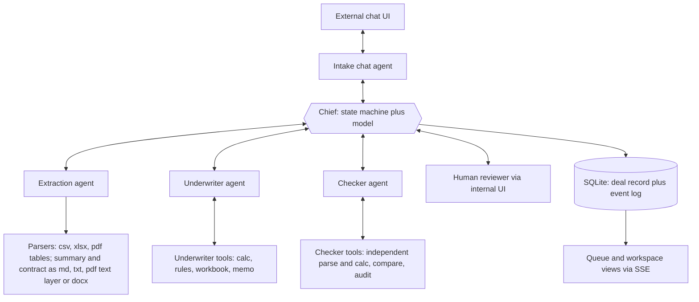

# Architecture

## 1. Shape of the system
Hub-and-spoke. The chief is a code state machine at the center. Agents are workers that the chief calls with a typed handoff and that return a typed result. Agents never call each other. All state lives in one versioned deal record plus an append-only event log in SQLite.

## 2. Layers and what is model vs code
| Layer | Model? | Notes |
| --- | --- | --- |
| Intake chat | Yes, narrow | Sees only checklist status and a short allowlist of fact keys. Never sees file contents. |
| Completeness | No | Code compares labels and facts to `config/checklist.yaml`. |
| Classification | Mostly no | Filename and header hints first; a model only picks a label from a fixed enum if both fail. |
| Extraction | Partly | Parsers read tables; a model maps unfamiliar columns and extracts narrative fields with quoted evidence. |
| Underwriting | Narrative only | Tools compute everything; the model drafts text with number placeholders. |
| Checker | Explanation only | Independent code recomputes; the model explains mismatches in plain English. |
| Chief | Edits and wording only | Transitions, retries, and escalation are code. |

## 3. Chief state machine
States: `CREATED`, `AWAITING_DOCS`, `READY`, `EXTRACTING`, `EXTRACTED`, `UNDERWRITING`, `UNDERWRITTEN`, `CHECKING`, `CHECKED`, `NEEDS_REVIEW`, `APPROVED`, `SENT_BACK`, `REJECTED`, `RELEASED`, `NEEDS_INPUT`, `FAILED`.

| From | Event | To |
| --- | --- | --- |
| CREATED / AWAITING_DOCS | upload or fact recorded, checklist incomplete | AWAITING_DOCS |
| AWAITING_DOCS | checklist complete | READY |
| READY | chief dispatches extraction | EXTRACTING |
| EXTRACTING | extraction result valid | EXTRACTED then UNDERWRITING |
| EXTRACTING | extraction invalid or key fields missing | NEEDS_INPUT |
| UNDERWRITING | tools complete | UNDERWRITTEN then CHECKING |
| CHECKING | status pass or warn | CHECKED then NEEDS_REVIEW |
| CHECKING | status fail and retries < 2 | UNDERWRITING (retry_count + 1) |
| CHECKING | status fail and retries = 2 | NEEDS_REVIEW with escalation flag |
| NEEDS_REVIEW | reviewer approves | APPROVED then RELEASED (MVP: locked snapshot only) |
| NEEDS_REVIEW | reviewer sends back (re-run) | SENT_BACK then UNDERWRITING |
| NEEDS_REVIEW | reviewer requests info from the sponsor | NEEDS_INPUT |
| NEEDS_INPUT | sponsor replies in words (deal already has a result) | NEEDS_REVIEW |
| NEEDS_INPUT | sponsor uploads a file, checklist complete | READY (then a new deal version) |
| NEEDS_REVIEW | reviewer rejects | REJECTED |
| any | unrecoverable error | FAILED |

Edits: a confirmed data patch bumps `deal_version` and re-enters at UNDERWRITING (invalidating memo, workbook, and check). A narrative edit re-renders the memo only. A judgment override stores an override record with a reason and does not change numbers.

## 4. Data flow (cached-fixture mode)
1. `POST /api/deals` creates a deal; the chat posts facts and files; code classifies and updates the checklist.
2. Chief dispatches extraction. Cached mode loads `extracted.json`; live mode parses and calls Claude. Output: validated `Deal` with `Sourced` fields.
3. Chief dispatches underwriting. The agent calls tools in order: metrics, exit sizing, stress, rules, workbook, memo. Output: `UnderwritingResult` plus files in `data/runtime/outputs/<deal_id>/v<N>/`.
4. Chief dispatches the checker with the raw file paths and the result. Output: `CheckReport`.
5. Chief writes `NEEDS_REVIEW`. The UI updates through server-sent events.
6. The reviewer decides. An approval or rejection also drafts a reply to the broker (`reply.drafted`), which the reviewer edits and approves; it is never sent.

## 5. Backend modules
| Module | Responsibility |
| --- | --- |
| `bridge/core/schema.py` | Pydantic models: `Sourced[T]`, `Deal`, `Metrics`, `UnderwritingResult`, `CheckReport`, `Event`, `Handoff`, `Patch` |
| `bridge/core/calc.py` | Pure metric and exit-sizing functions |
| `bridge/core/edit.py` | One way to change a deal input on a copy (shared by confirmed edits and what-ifs) |
| `bridge/core/scenario.py`, `sizing.py` | What-ifs (the real underwriting on a copy; nothing saved) and the largest loan that screens |
| `bridge/core/rules.py` | Loads `config/rules.yaml`; returns call and reason codes |
| `bridge/core/completeness.py` | Checklist status from labels and facts |
| `bridge/core/parsers/` | CSV, XLSX and PDF tables (`pdftable.py`); markdown, text, PDF and Word documents (`documents.py`); model-assist protocol and verification (`assist.py`); classify |
| `bridge/core/builders/` | `workbook.py`, `memo.py` |
| `bridge/core/independent/` | Checker's own parser and formulas (no imports from `calc.py` or `parsers/`) |
| `bridge/agents/runner.py` | `AgentRunner` interface; Claude and cached implementations |
| `bridge/agents/{chief,intake,extraction,underwriter,checker}.py` | Agent logic (see `docs/agents.md`) |
| `bridge/agents/{chief_chat,intake_replies,phrasing,broker_reply}.py` | Chat replies composed by code, the check on model rewording, and the draft reply to the broker |
| `bridge/agents/tools/` | Tool registries and JSON schemas for each agent |
| `bridge/store/` | SQLite access, deal record, event log, patches |
| `bridge/api/` | FastAPI routes and SSE streams |

## 6. Runtime
- Localhost only. Backend on port 8000, frontend on 5173 with a dev proxy to the backend.
- SQLite file at `data/runtime/bridge.db`; uploads and outputs under `data/runtime/`.
- Agent work runs in a background task per deal; progress is published as events, never by polling the model.
- Config: `.env` (key, model name, paths). No auth in the MVP.

## 7. Security and safety notes
- The intake agent has a separate tool allowlist: `get_checklist_status`, `record_fact` (allowlisted keys), `register_upload`. It cannot read deals or outputs.
- File contents are untrusted. Extraction wraps them in delimiters and forces a single `submit_extraction` tool with a strict schema.
- Secrets never enter prompts, logs, or events.
- Every model call is logged with prompt version, model name, and token counts (no secrets).
